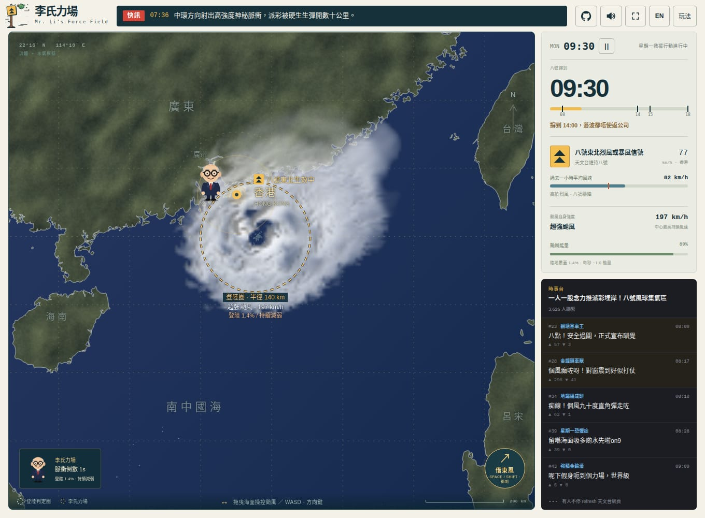
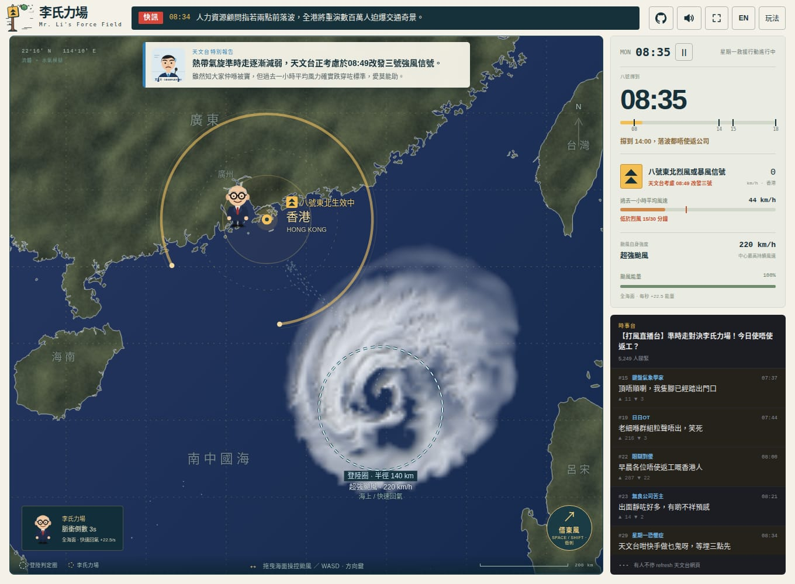
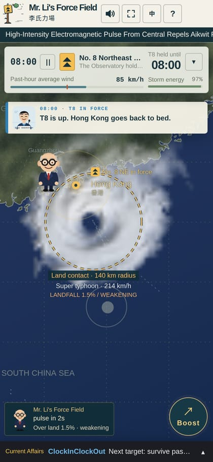
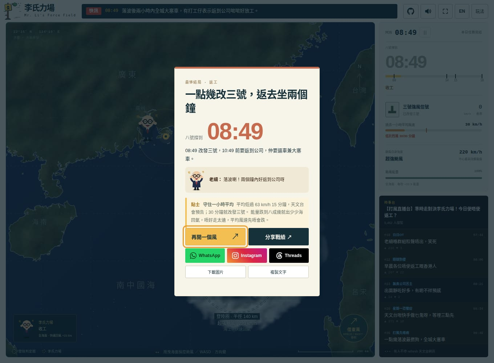

# 李氏力場 · Mr. Li's Force Field

**呢個風假，自己爭取。** You are the typhoon. Break through Hong Kong's legendary force field and win the city a Signal No. 8 day off.

A two-minute parody arcade game about the most Hong Kong feeling there is: staring at the Observatory's website at 6 a.m., praying the No. 8 goes up before you have to leave for work. In Cantonese and English, on desktop and phone.

**[▶ Play in your browser](https://michaellee8.github.io/typhoon/)** · no install, about two minutes a round



## The joke

Hong Kong people swear that typhoons swerve around the city at the last moment, bounced away by an invisible shield the internet calls 李氏力場 (the "Li force field"), supposedly kept up by a tycoon who'd rather everyone came in to work. Typhoon Signal No. 8 is the magic number: when it is up, offices close and the city stays in bed.

So you play the storm. A smug boss in a pinstripe suit pulses his force field to shove you out to sea. The forum thread loses its mind. You need No. 8 hoisted before the 08:00 commute, then held as long as you can.

## How to play

- **Steer**: drag anywhere on the sea, or WASD / arrow keys.
- **Boost** (借東風): Space, Shift or the button punches through a force-field pulse. On a phone, a second finger boosts while the first steers.
- **Energy**: open sea recharges the storm. Any land under the 140 km contact circle drains it, small islands included.
- **The day**: Monday runs 07:00 to 18:00 in about 110 seconds.
  - No No. 8 at 08:00: everyone commutes, and you lose.
  - After 08:00, the Observatory watches Hong Kong's **past-hour average wind**. Fifteen minutes under gale force and it warns it is considering No. 3. At thirty minutes it issues No. 3 and the day is over.
- **Endings** depend on when No. 8 comes down:
  - before 14:00: back to the office through the traffic;
  - 14:00 to 15:00: the boss's work-from-home memo;
  - from 15:00: a pass;
  - still up at 18:00: the big win.

<p>
  
  
</p>

## What's inside

- **Clouds from a real fluid solver, not a spinning sprite.** A Web Worker integrates 2D fluid momentum with pressure projection, Coriolis deflection, terrain drag, moisture, condensation, rain-out and eye subsidence, using Stam's Stable Fluids and bounded MacCormack advection. Old cloud bands persist and drift off as you move the storm.
- **Hong Kong's actual typhoon-day rules.**
  - Signals follow HKO's wind definitions.
  - The Observatory's No. 3 warning and downgrade timing work as described above.
  - Real HKO signal symbols; No. 8 shows the quadrant the gales blow from.
  - Work rules follow the Labour Department's code of practice: the 08:00 commute gate, back within two hours, the 14:00 work-from-home call.
- **A voiced Observatory.** Cantonese announcements for No. 8 at 08:00 and for every No. 3 warning and cancellation. These use an AI voice, disclosed in the game.
- **A forum that reacts.** A LIHKG-style thread with 168 posts and a BREAKING ticker of 45 deadpan headlines react to every bounce, landfall and downgrade. A fresh made-up typhoon name each round.
- **Written in Cantonese first.** The English is an adaptation, not a literal translation. Switch with EN / 中.
- **One screen, like an app.** Desktop shows the map with a status card and the thread. On phones the map fills the screen, the panels fold into strips, and the installed web app opens fullscreen.
- **A share card.** It renders a 1080×1350 image of your final map and result, with WhatsApp, Instagram and Threads buttons.
- **No build step, no runtime dependencies.** Plain ES modules, Canvas 2D, HTML and CSS: about 7,600 lines, with 1.4 MB of assets including the voice clips.



## Run it locally

Any static file server works:

```sh
pnpm dev                          # node scripts/serve.mjs → http://127.0.0.1:8080
# or
python3 -m http.server -d public 8080
```

Add `?lang=en` to the URL to start in English.

## Tests

```sh
pnpm install
pnpm exec playwright install chromium
pnpm check
```

`pnpm test` runs the rule, wind-model and fluid regressions in Node.

`pnpm check` adds a full visual playtest in headless Chromium:

- It plays whole days on desktop and phone with **real mouse, keyboard and touch input**. It never calls into game state; `window.__typhoon` is read-only.
- It covers every ending, the Observatory's warning and downgrade, both languages, pause, boost, restart and the share buttons.
- Along the way it saves 32 screenshot checkpoints and audits hit targets and viewport bounds.

Output goes to `artifacts/`.

## Make it yours

- **Music**: none ships. Put a track in `public/audio/` and set `MUSIC_SRC` in `public/audio.js`. It loops well under the effects, ducks under the Observatory's voice, and gets its own mute button.
- **Analytics**: `public/analytics.js` is a no-op. Point `track()` at your own analytics if you host the game.
- **Voice clips**: `pnpm voice` rebuilds `public/audio/hko/` with MiniMax TTS. It needs `MINIMAX_API_KEY` and [uv](https://docs.astral.sh/uv/). The script also holds the Cantonese pronunciation fixes the TTS needs.
- **Icons and social cover**: `pnpm brand` rebuilds them from `public/logo.svg` and `public/favicon.svg`. It needs ImageMagick.
- **Hosting**: `public/` is the whole site. `.github/workflows/pages.yml` publishes it to GitHub Pages on every push to `main`. Turn it on in Settings → Pages → Source: GitHub Actions.

## Project layout

| Path                                     | What                                                                |
| ---------------------------------------- | ------------------------------------------------------------------- |
| `public/game.js`                         | game loop, input, HUD, endings                                      |
| `public/weather.js`, `geography.js`      | storm, wind field, land contact, map projection                     |
| `public/atmosphere.js`, `satellite*`     | the fluid and moisture solver and its worker                        |
| `public/rules.js`, `hko.js`              | the working day, the Observatory's averaging, warning and downgrade |
| `public/signals.js`                      | HKO signal symbols                                                  |
| `public/copy.js`, `i18n.js`, `feed.js`   | Cantonese and English copy, forum thread, ticker                    |
| `public/boss.js`, `share.js`, `audio.js` | the boss, the share card, Web Audio and voice                       |
| `scripts/`                               | tests, playtest harness, map, icon and voice builders               |
| `research/`                              | notes on typhoon size and Hong Kong's typhoon work rules            |

## Sources and thanks

- Inspired by [Taistorm](https://nonightcream.github.io/Taistorm/) and [Typhoon Day Off](https://trueflies0717.github.io/typhoon/).
- Coastline: [Natural Earth](https://www.naturalearthdata.com/) 1:10m countries (public domain). Rebuild it with `node scripts/prepare-map.mjs /path/to/ne_10m_admin_0_countries.geojson`.
- Fluids: [Stam, _Stable Fluids_](https://www.dgp.toronto.edu/public_user/stam/reality/Research/pdf/ns.pdf); GPU Gems, [_Fast Fluid Dynamics Simulation on the GPU_](https://developer.nvidia.com/gpugems/gpugems/part-vi-beyond-triangles/chapter-38-fast-fluid-dynamics-simulation-gpu); GPU Gems 3, [_Real-Time Simulation and Rendering of 3D Fluids_](https://developer.nvidia.com/gpugems/gpugems3/part-v-physics-simulation/chapter-30-real-time-simulation-and-rendering-3d-fluids).
- Storm size: [HKO, structure of typhoons](https://www.hko.gov.hk/en/education/tropical-cyclone/classification-naming-characteristics/00147-structure-of-typhoons.html), the [HKO empirical wind model](https://www.hko.gov.hk/tc/publica/reprint/files/r799.pdf) and the [Rose report](https://www.hko.gov.hk/en/informtc/no10/rose/rose.htm). Details and limits are in [research/typhoon-size.md](research/typhoon-size.md).
- Wind definitions: [HKO cyclone classes](https://www.hko.gov.hk/en/informtc/class.htm) and [local warning signals](https://www.hko.gov.hk/en/publica/tc/tc2024/table14.html). Work rules are in [research/typhoon-work-rules.md](research/typhoon-work-rules.md).

## Disclaimer

This is a parody. The wind field, forecast, work schedule and scoring are game rules, not a weather forecast or employment advice. The force field is an internet joke. The boss, the Observatory spokesperson and every forum user are fictional. The Observatory's voice is AI-generated and imitates no real person. The game is not affiliated with the Hong Kong Observatory.

## Rights

© 2026 michaellee8. All rights reserved.

The source is public so you can read it, learn from it and play it. It is **not** open source: no license is granted to copy, modify or redistribute it. Bug reports and ideas are welcome in Issues.

If it made you laugh, or you've also refreshed the Observatory page at 6 a.m., a ⭐ helps a lot.
